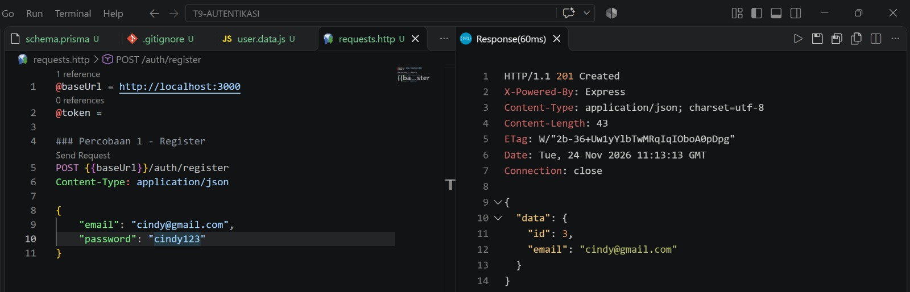
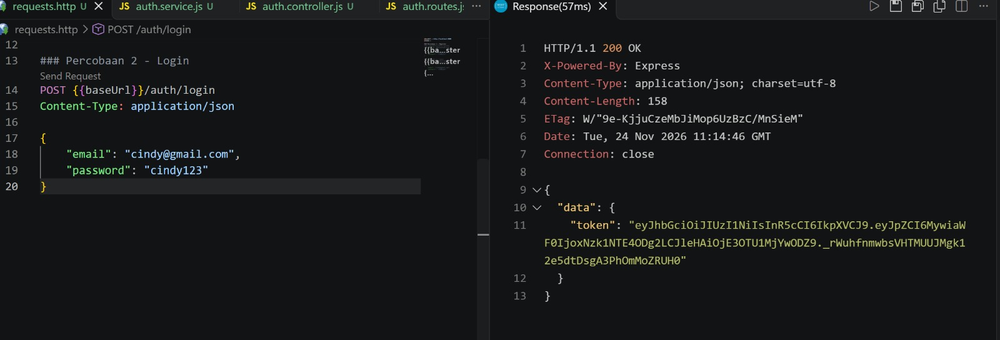
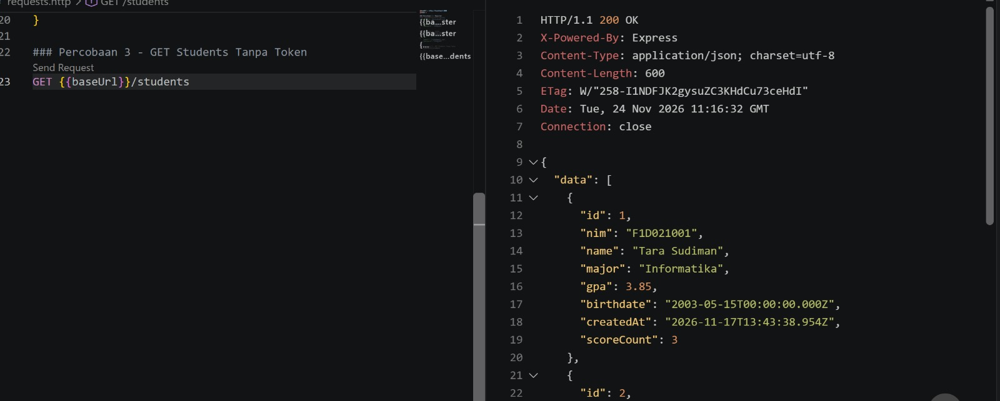
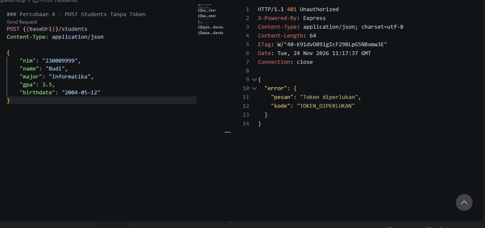
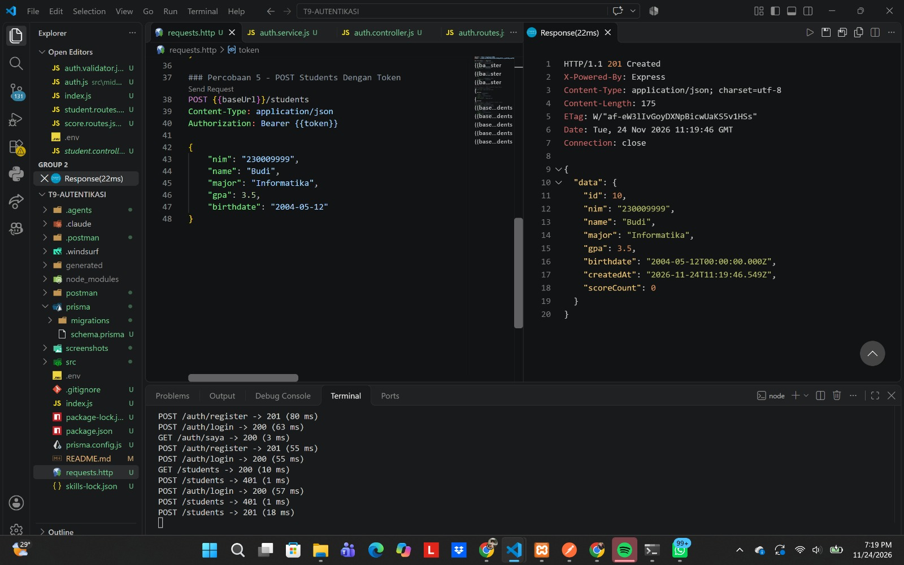
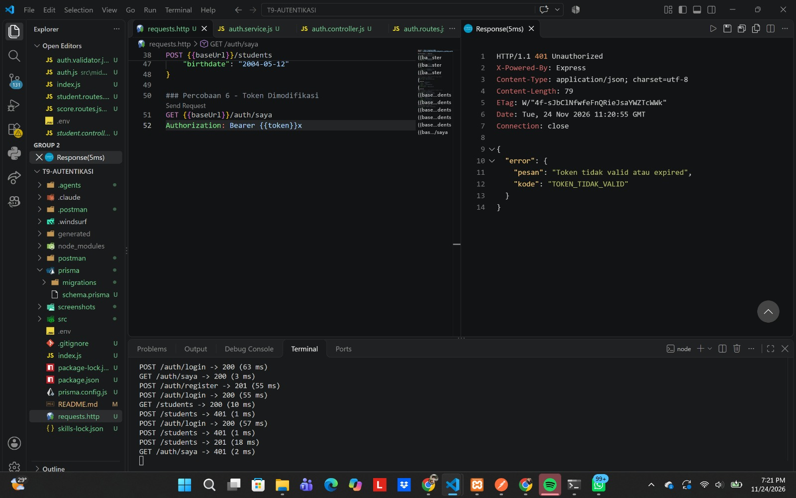
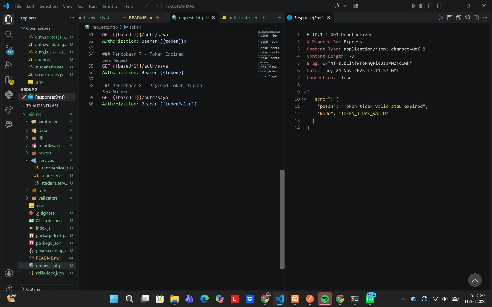

# Tugas 9 - Autentikasi & Otorisasi

## Identitas

- **Nama:** Cindy Natasya Aulia Putri
- **NIM:** F1D202310109
- **Kasus ETS:** Students API

## Cara Menjalankan

1. Buka folder project `T9-AUTENTIKASI` di Visual Studio Code.
2. Buka terminal pada folder project.
3. Jalankan perintah berikut untuk menginstal dependency:

   ```bash
   npm install
   ```

4. Pastikan konfigurasi database MySQL dan `JWT_SECRET` sudah tersedia pada file `.env`.
5. Jalankan migrasi database:

   ```bash
   npx prisma migrate dev
   ```

6. Jalankan server:

   ```bash
   npm run dev
   ```

7. Setelah server berjalan, API dapat diakses melalui:

   ```text
   http://localhost:3000
   ```

8. Pengujian endpoint dapat dilakukan menggunakan REST Client melalui file `requests.http`.
   ```

## Akun Uji

Akun berikut digunakan untuk menguji proses registrasi dan login pada API.

| Email | Password |
|---|---|
| cindy@gmail.com | cindy123 |

Akun dibuat melalui endpoint `POST /auth/register`. Password disimpan dalam database dalam bentuk hash menggunakan bcrypt, bukan dalam bentuk teks biasa.

## Struktur Proyek

Berikut gambaran struktur proyek Students API:

```text
pwl26-mini-project/
│
├── prisma/
│   ├── migrations/
│   └── schema.prisma
│
├── src/
│   ├── controllers/
│   ├── middleware/
│   ├── routes/
│   ├── services/
│   └── data/
│
├── generated/
│   └── prisma/
│
├── .env
├── .gitignore
├── index.js
├── package.json
├── package-lock.json
├── prisma.config.js
├── requests.http
└── README.md
```

**Keterangan:**

- `prisma/schema.prisma`: Mendefinisikan model dan struktur tabel database.
- `prisma/migrations/`: Menyimpan riwayat perubahan struktur database.
- `src/controllers/`: Menangani request dan response dari client.
- `src/middleware/`: Menangani middleware, termasuk pemeriksaan token autentikasi.
- `src/routes/`: Mendefinisikan endpoint API.
- `src/services/`: Menangani proses bisnis dan logika aplikasi.
- `generated/prisma/`: Berisi Prisma Client yang dihasilkan oleh Prisma.
- `index.js`: File utama untuk menjalankan server Express.
- `requests.http`: Berisi kumpulan request untuk pengujian endpoint API.
- `package.json`: Menyimpan informasi project, dependency, dan perintah untuk menjalankan aplikasi.
- `.env`: Menyimpan konfigurasi lingkungan seperti koneksi database dan JWT secret.

## Endpoint

Endpoint pada Students API dibagi menjadi endpoint publik dan endpoint yang memerlukan autentikasi.

| Method | URL | Akses | Keterangan |
|---|---|---|---|
| POST | `/auth/register` | Publik | Mendaftarkan akun baru |
| POST | `/auth/login` | Publik | Login dan memperoleh JWT |
| GET | `/auth/saya` | Wajib login | Menguji autentikasi dan memperoleh informasi pengguna |
| GET | `/students` | Publik | Melihat daftar student |
| POST | `/students` | Wajib login | Menambahkan data student |

**Keterangan:**

- Endpoint publik dapat diakses tanpa token autentikasi.
- Endpoint yang memerlukan login harus menyertakan JWT pada header `Authorization` dengan format `Bearer [token]`.

## Pengujian

Pengujian dilakukan menggunakan REST Client pada Visual Studio Code melalui file `requests.http`.

Hasil pengujian yang dilakukan meliputi:

1. **Registrasi akun:** Menguji pembuatan akun baru dengan hasil `201 Created`.
2. **Login:** Menguji autentikasi menggunakan email dan password dengan hasil `200 OK`.
3. **Akses endpoint publik:** Mengakses daftar student tanpa token dengan hasil `200 OK`.
4. **Akses endpoint terlindungi tanpa token:** Mengakses endpoint penambahan student tanpa token dengan hasil `401 Unauthorized`.
5. **Akses endpoint terlindungi menggunakan token:** Menambahkan data student menggunakan JWT yang valid dengan hasil `201 Created`.

**Dokumentasi screenshot:**

Simpan screenshot hasil pengujian di dalam folder `screenshot/`.

## Pengujian

Dokumentasi hasil pengujian API menggunakan REST Client disajikan pada tabel berikut.

| No. | Screenshot | Keterangan |
|---|---|---|
| 1 |  | Hasil registrasi akun |
| 2 |  | Hasil login dan memperoleh token JWT |
| 3 |  | Akses endpoint publik tanpa token |
| 4 |  | Akses endpoint protected tanpa token |
| 5 |  | Akses endpoint protected menggunakan token valid |
| 6 |  | Password tersimpan dalam bentuk hash pada database |
| 7 |  | Hasil pengujian token yang dimodifikasi |
| 8 |  | Hasil pengujian token kedaluwarsa |

## Dua Percobaan

### Percobaan 1 - Token Dipalsukan

Percobaan ini dilakukan dengan mengubah payload JWT, misalnya mengganti nilai `id` pengguna, tanpa mengetahui secret key yang digunakan oleh server.

Setelah token yang payload-nya telah diubah dikirimkan ke endpoint yang memerlukan autentikasi, server memberikan respons `401 Unauthorized` dengan kode `TOKEN_TIDAK_VALID`.

Hal ini terjadi karena JWT menggunakan signature untuk memastikan integritas token. Meskipun payload dapat dibaca dan dimodifikasi, perubahan tersebut menyebabkan signature tidak lagi sesuai sehingga token ditolak oleh server.

**Screenshot:** 

### Percobaan 2 - Token Expired

Percobaan ini dilakukan dengan mengubah sementara konfigurasi masa berlaku token pada file `auth.service.js` dari `2h` menjadi `5s`.

Setelah melakukan login untuk mendapatkan token, pengujian dilakukan dengan menunggu selama 6 detik sebelum mengakses endpoint yang memerlukan autentikasi.

Hasil pengujian menunjukkan respons `401 Unauthorized` dengan kode `TOKEN_TIDAK_VALID` karena token telah melewati waktu kedaluwarsanya. Server dapat mengetahui masa berlaku token melalui informasi `exp` yang terdapat pada payload JWT tanpa harus menyimpan setiap token di database.

Setelah pengujian selesai, konfigurasi masa berlaku token dikembalikan menjadi `2h`.

**Screenshot:**  

## Deklarasi Penggunaan AI

Dalam pengerjaan tugas ini, saya menggunakan bantuan AI sebagai sarana pendukung pembelajaran dan pengembangan aplikasi.

| Bagian | Alat AI | Digunakan untuk | Cara Memeriksa Hasil |
|---|---|---|---|
| Pemahaman kode | ChatGPT | Membantu memahami konsep autentikasi, otorisasi, JWT, dan middleware | Mempelajari kembali kode dan mencocokkan dengan materi perkuliahan |
| Pengembangan API | ChatGPT | Membantu memahami dan memperbaiki kode pada proses autentikasi | Menjalankan aplikasi dan menguji setiap endpoint |
| Pengujian | ChatGPT | Membantu menyusun skenario pengujian token valid, token palsu, dan token expired | Melakukan pengujian langsung menggunakan REST Client |
| Dokumentasi | ChatGPT | Membantu menyusun dokumentasi README.md | Memeriksa kesesuaian dokumentasi dengan implementasi project |

Contoh prompt yang digunakan:

> Bantu saya memahami cara kerja autentikasi JWT pada Express.js secara bertahap, mulai dari register, login, hingga middleware untuk memeriksa token.

Seluruh hasil bantuan AI diperiksa kembali dengan mempelajari kode, menjalankan aplikasi, dan melakukan pengujian secara langsung.

## Kesimpulan & Kendala

### Kesimpulan

Berdasarkan pengerjaan tugas ini, dapat disimpulkan bahwa:

1. **Mengapa password disimpan dalam bentuk hash, bukan dienkripsi?**

   Password disimpan menggunakan hashing agar password asli tidak dapat dikembalikan secara langsung dari hasil penyimpanan. Hashing bersifat satu arah sehingga lebih aman apabila database mengalami kebocoran. Pada proses login, password yang dimasukkan akan dibandingkan dengan hash yang tersimpan menggunakan bcrypt.

2. **Mengapa pesan kegagalan login untuk email yang tidak terdaftar dan password yang salah dibuat sama?**

   Pesan kegagalan dibuat sama untuk mencegah pihak lain mengetahui apakah suatu email terdaftar atau tidak. Hal ini membantu mengurangi risiko penyalahgunaan informasi akun oleh pihak yang tidak berwenang.

3. **Apa perbedaan halaman publik dan halaman yang dilindungi (protected)?**

   Endpoint publik dapat diakses tanpa melakukan login atau mengirimkan token. Sementara itu, endpoint protected hanya dapat diakses apabila pengguna menyertakan token JWT yang valid pada header Authorization.

### Kendala

Kendala yang ditemui selama pengerjaan adalah memahami proses autentikasi menggunakan JWT, penerapan middleware untuk melindungi endpoint, serta pengujian token yang dimodifikasi dan token yang telah kedaluwarsa.

Kendala tersebut diselesaikan melalui pemeriksaan kode, pemahaman alur autentikasi, dan pengujian endpoint menggunakan REST Client.